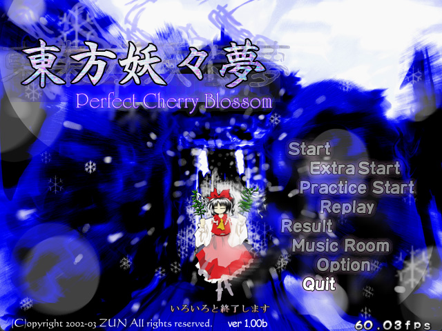
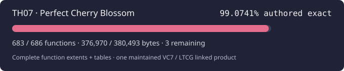

# 東方妖々夢 ～ Perfect Cherry Blossom

<p align="center"></p>
<p align="center"></p>

Source reconstruction of the original Japanese **TH07 1.00b**, accepted through
complete function-byte comparisons against the original executable.

The reviewed authored scope currently has **678 / 686 exact functions** and
**373,295 / 380,493 exact bytes (98.1082%)**. Prebuilt SDK/CRT library code, SDK inline routines, compiler-generated
wrappers, alignment and embedded SDK data are excluded from that denominator.
Comparison includes complete compiler extents and trailing switch tables;
relocation fields are independently resolved and compared without masking.

| Measurement | Exact functions | Exact coverage bytes |
| --- | ---: | ---: |
| Unmodified some100 reference, 694 named functions | 682 / 694 | 341,585 / 381,170 (89.6149%) |
| Maintained native LTCG build, same named scope | 683 / 694 | 371,049 / 381,170 (97.3448%) |
| Reviewed authored source pool | 678 / 686 | 373,295 / 380,493 (98.1082%) |

The source pool combines the maintained native build with **four preserved,
freshly rebuilt COFF implementations**. The first two rows include eight
SDK/compiler routines; the authored row also excludes an assembler-only helper
from exact acceptance. The eight remaining authored routines are recorded in
[config/remaining.csv](config/remaining.csv). These figures establish function
bytes; whole-executable equivalence and runtime playability remain unverified.
See [the oracle and measurement limits](docs/ORACLE.md).

## Target

Provide your own original executable as `resources/th07.exe`. Original game
binaries, data, toolchains, reference clones, PDBs and analysis databases are
excluded from this repository.

| Property | Required value |
| --- | --- |
| Version | Original Japanese 1.00b |
| File size | 650,752 bytes |
| SHA-256 | `35467eaf8dc7fc85f024f16fb2037255f151cefda33cf4867bc9122aaa2e80ca` |
| Image base / entry point | `0x00400000` / `0x0047EA7D` |

```bash
python3 scripts/verify-target.py
```

## Headless setup and replay

Linux prerequisites: Python 3.11+, Git, Wine with 32-bit support, `taskset`,
`nice` and `flock`. Every analysis and Wine invocation is headless. Ghidra uses
one CPU and at most 2 GiB heap; compilers share one serial process lock.

```bash
python3 -m pip install -r requirements.txt
python3 scripts/bootstrap-tools.py
python3 scripts/ghidra.py initialize
python3 scripts/ghidra.py check
python3 scripts/build-whole.py
python3 scripts/replay-legacy-units.py --units enemy-lifecycle bullet-manager replay-added
python3 scripts/replay-exact-units.py
```

Bootstrap pins are in [config/tools.lock.toml](config/tools.lock.toml). Existing
tools can be reused with `--msvc700 PATH --dx8sdk PATH --ghidra-home PATH
--jdk-home PATH`. Shared toolchains are left intact; the frontend wrapper and
legacy layout are prepared locally. Wine's prefix lives outside the checkout.
The baseline is separately reproducible:

```bash
python3 scripts/build-reference.py
python3 scripts/reference-oracle.py
```

Public CI validates accounting, source provenance and synthetic positive/negative
oracle controls without proprietary inputs. Local exact replay requires the
original target and private build artifacts. Rebuild and compare one accepted
function with `python3 scripts/replay-exact-units.py --unit f_00410520 --rebuild`.

## Documentation

- [Architecture and source layout](docs/ARCHITECTURE.md)
- [Strict oracle, reference import and remaining work](docs/ORACLE.md)
- [Application/runtime boundary review](docs/BOUNDARY_REVIEW.md)
- [Headless workflow and Ghidra commands](docs/RE_WORKFLOW.md)
- [Build products and evidence](docs/EXECUTABLE_BUILD.md)
- [Current generated progress](docs/PROGRESS.md)
- [Historical focused probes](docs/BUILD_MATCHING.md)
- [Historical SDK/runtime recovery](docs/LIBRARY_RECOVERY.md)
- [Agent rules](AGENTS.md)

## Credits and license

The maintained `src/th07/` source and Japanese localization table derive from
**[some100/th07](https://github.com/some100/th07)**, pinned at
[`4878bf0`](https://github.com/some100/th07/tree/4878bf0e42a9280ef44735eb0517d4fda7cb6e04).
Thank you to its contributors for the reconstruction. Its CC0 dedication is
preserved in [docs/LICENSE-some100.txt](docs/LICENSE-some100.txt); original and
maintained file hashes are tracked in `config/*source-provenance.json`.
The local type correction makes `g_SpellcardScore` signed, matching TH07's
32-bit signed x87 conversion and recovering the complete ECL procedure.

[GensokyoClub/th06](https://github.com/GensokyoClub/th06) and
[GensokyoClub/th08](https://github.com/GensokyoClub/th08) provided engine and VC7
workflow references. The pinned `var_order` frontend shim is credited to
[EstexNT](https://gist.github.com/EstexNT/e98a1384b906a3eedaaa3eeb7e58cd9d).
Existing codec notices and Mark Nelson's LZSS notice remain in their source;
see also [third_party/README.md](third_party/README.md).

Repository-authored tools and documentation use the [MIT License](LICENSE).
Imported source retains its applicable notices and license. Touhou Project and
its game assets belong to their respective rights holders.
